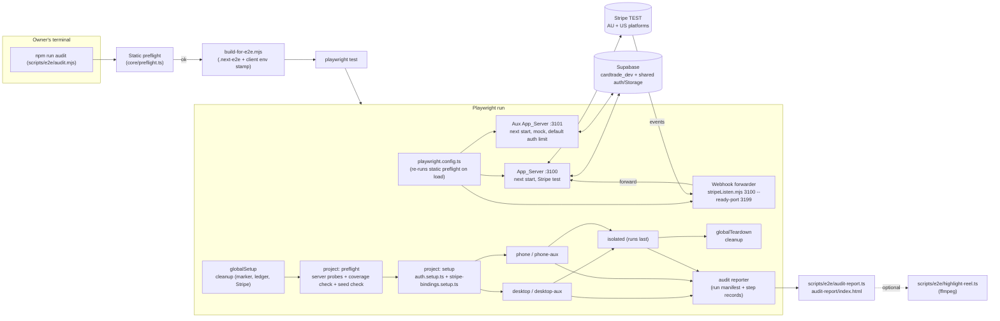

# Design Document: e2e-ux-audit-suite

## Overview

The Audit_Suite is the existing Playwright harness, grown into one suite that proves every member-facing function on the dev sandbox and leaves behind evidence the owner can read: step screenshots, one video per member per viewport, automated UX and copy observations, and a static HTML report.

It is built by extending what is already in the repository, not beside it:

- `playwright.config.ts` stays the single config. It loses the `next dev` mode and the forced `PAYMENTS_PROVIDER=mock`, and gains a Stripe-test App_Server, an auxiliary mock App_Server, a Stripe webhook forwarder, and viewport projects.
- `tests/e2e/auth.setup.ts`, `support/auth.ts` (F14 session repair), `support/fixtures.ts` (Places stub on every context), `support/db.ts`, `support/users.ts`, `support/marker.ts`, `support/waiting.ts` and the flow helpers (`listings`, `deals`, `payments`, `forms`, `messageSeller`, `places`) are reused as they are, with additions listed under Components.
- The specs in `tests/e2e/specs/` are migrated in place onto a small Pathway DSL. No second spec is written for a flow an existing spec already drives (Req 3.2).
- `scripts/e2e/cleanup-test-data.ts`, `build-for-e2e.mjs` and `scripts/dev/stripeListen.mjs` are extended. `playwright.stripe.config.ts` and `tests/e2e/stripe/bank-rails.stripe.ts` are folded into the main suite and retired.

Everything the suite decides (is this run safe, is coverage complete, what to mask, which copy breaks a rule, which observation blocks, what the report says) lives in pure modules under `tests/e2e/audit/core/`, which the Vitest `domain` project tests with fast-check. The Playwright layer only gathers inputs for those functions and acts on their answers.

### Decisions already made (from the owner)

| Decision | Consequence in this design |
| --- | --- |
| Sandbox only: `cardtrade_dev` plus Stripe TEST keys. No production check. | Preflight aborts on any other schema or any live key. `E2E_ALLOW_PRODUCTION_SCHEMA` is removed. |
| Google OAuth out of scope | One Out_Of_Scope_Entry in the Coverage_Map, nothing else. |
| Mock provider or signed fixtures only for events Stripe test mode cannot produce on demand | Early fraud warnings, chargeback outcomes, Ship24 and carrier events, hold expiry and every other elapsed-time state. Each such step is a Simulated_Step with its mechanism named. |
| Desktop and phone video; one video per member in two-party flows | Every member context records its own video at the project viewport. |
| Optional highlight reel of at most 90 s, cash-sale and trade lifecycles first | `scripts/e2e/highlight-reel.ts` with a checked-in selection list. `ffmpeg` is already on this machine (`C:\Users\Phil\scoop\shims\ffmpeg.exe`), so nothing needs installing. |

### Research findings that shape the design

- **Playwright starts `webServer` before `globalSetup`.** A server-side probe can therefore run in a `preflight` setup project, but a check that must happen before any server starts has to run when the config module loads. The design does both (see Safety preflight).
- **Playwright `webServer` accepts an array**, each entry waited on by `url` or `port`. That is how one run gets the Stripe server, the auxiliary server and the webhook forwarder ([Playwright docs: web server](https://playwright.dev/docs/test-webserver)).
- **Video is per page.** `recordVideo` is a context option; `page.video().saveAs()` is available after the context closes. Contexts a spec opens with `browser.newContext` do not inherit `use.video`, so the existing `browser.newContext` patch in `support/fixtures.ts` is the place to add `recordVideo` ([Playwright docs: videos](https://playwright.dev/docs/videos)).
- **`page.screenshot({ mask })` masks screenshots but not video.** Masking video needs an in-page overlay that is drawn into every frame. The design uses a closed shadow-root overlay so masking does not change the text that assertions read.
- **Playwright traces store action parameters and network bodies as text** inside the zip, including the value given to `fill()`. The seeded password and any client secret would land there, so traces are scrubbed before the report links them.
- **Same test card, same fingerprint.** Stripe test PaymentMethods made from one card number share a `card.fingerprint` within a platform account. The app's `RELATED_ACCOUNTS` guard refuses two members who share a card, so every bound member gets a different test card number, and the related-accounts pathway shares one on purpose.
- **`/api/health` reports the payments kind (`resolvePaymentProvider`) but not the schema or test/live mode.** Requirement 1.4 needs both, so two fields are added (see Components).
- **`lib/rateLimit.ts` keys an anonymous caller by the first `x-forwarded-for` address.** A context can set a TEST-NET address (`203.0.113.x`) as an extra header and get a rate-limit bucket of its own, so the rate-limit pathway does not throttle other workers' sign-ins.
- **`scripts/e2e/cleanup-test-data.ts` and `support/db.ts` default the schema to `cardtrade` when the variable is unset.** With service-role deletes that is the most dangerous default in the harness. Both now refuse any schema other than `cardtrade_dev`.
- **The seeded profiles carry mock provider refs** (`payer_alice`, `mch_seed_alice`), which real Stripe rejects. `bank-rails.stripe.ts` worked around this per test by patching and restoring. The design binds seed members to real test objects once per run instead (see Stripe bindings).
- **`package.json` has no axe package.** `@axe-core/playwright` is the one new dev dependency the design needs. It is added only with the owner's approval at implementation time.
- **`ux-review:capture` points at `playwright.ux-review.config.ts`, which does not exist.** The script is removed.

## Architecture



### Servers

Both App_Servers are `next start` over the same production build in `.next-e2e` (Req 4.1). The `next dev` branch of the current config, and its `E2E_PRODUCTION_SERVER` switch, are removed: every spec has been verified against a production server since `test:e2e:prod`, and F5, F17 and F70 recorded the cost of the dev server.

| Server | Port | Payments | Why it exists |
| --- | --- | --- | --- |
| Main | 3100 | `PAYMENTS_PROVIDER=stripe`, the `.env.local` test keys | Every Pathway that collects, holds, refunds or transfers money (Req 4.3), and every non-money Pathway by default. |
| Aux | 3101 | `PAYMENTS_PROVIDER=mock`, `ALLOW_MOCK_PAYMENTS_IN_PRODUCTION=true`, `ENABLE_PAYMENT_DEMO=true`, `WEBHOOK_SECRET` | Pathways declared `provider: 'mock'` only (Req 4.4), and the auth rate-limit Pathway, because this server keeps the default limit of 5 per minute. |

The main server keeps `AUTH_RATE_LIMIT_PER_MINUTE=100` because `auth.setup.ts` signs nine members in from one address. Each server's `WEBHOOK_URL` is its own port (F20, Req 4.6). `E2E_RUN_ID` is passed to both, which is how the app stamps Stripe objects (see Stripe metadata).

The mock-only list is short by design. The default mechanism for an event Stripe cannot produce on demand is a **signed fixture against the main server**, built from the real test objects the Pathway created, so the rest of the Pathway still runs on real Stripe. The aux server is used only where no real object can stand behind the event.

### Webhook_Source

`scripts/dev/stripeListen.mjs` already runs one `stripe listen` per configured test platform, refuses non-test keys and checks the listener secrets are in `STRIPE_WEBHOOK_SECRET`. It gains a `--ready-port <n>` option that serves `200` on `/ready` once every listener has printed `Ready!`. The config adds it as a third `webServer` entry (`node scripts/dev/stripeListen.mjs 3100 --ready-port 3199`, `url: http://localhost:3199/ready`), so the run waits for forwarding instead of the owner having to remember a second terminal. Its output is relayed through the Masker's scrubber.

If the listener secret is missing from `STRIPE_WEBHOOK_SECRET`, the script already exits non-zero with instructions, and Playwright reports the forwarder failing to start.

### Jobs, cron and elapsed time

| Mechanism | Helper | How |
| --- | --- | --- |
| Job_Endpoint | `audit/backend/jobs.ts` `runJob(name, { auth })` | `POST http://localhost:3100/api/jobs/<name>` with `Authorization: Bearer <JOBS_SECRET>` read through `envValue`. `auth: 'none' | 'wrong'` drives the refusal Pathways (Req 26.2). Returns the parsed JSON summary for assertions. |
| Cron_Function | `audit/backend/cron.ts` `runCron(name)` | Runs `select cardtrade_dev.<name>()` through the Supabase management query endpoint, the same transport `scripts/dev/applyToDev.mjs` uses (`scripts/dev/lib.mjs`, `SUPABASE_PAT`). The SQL text comes only from `core/cron.ts` `cronInvocationSql(name)`, which accepts names on an allow-list and always qualifies `cardtrade_dev`. |
| Elapsed time | `audit/backend/timeTravel.ts` `rewind(table, id, columns, durationMs)` | Moves the named timestamp columns back with the service role (`updateRows`). The patch comes from `core/timeTravel.ts` `rewindPatch`. Always called inside a `simulated(..., { mechanism: 'moved-timestamp' })` step (Req 26.4). |

The cron allow-list starts with the four pg_cron bodies named in `product.md` (`auto_complete_due_cash_sales`, `warn_expiring_holds`, `expire_lapsed_holds`, `enforce_trade_shipping_deadlines`). The implementer confirms each name against `cron.job` in production before adding it, because the clone does not copy jobs.

### Projects

| Project | Device | Server | Selects | Depends on |
| --- | --- | --- | --- | --- |
| `preflight` | none | both | `audit/preflight.setup.ts` | — |
| `setup` | Desktop Chrome | main, aux | `auth.setup.ts`, `audit/stripe-bindings.setup.ts` | `preflight` |
| `desktop` | Desktop Chrome | main | `specs/**/*.spec.ts`, `grepInvert: /@aux|@isolated/` | `setup` |
| `phone` | iPhone 14, WebKit | main | same | `setup` |
| `desktop-aux`, `phone-aux` | as above | aux | `grep: /@aux/` | `setup` |
| `isolated` | Desktop Chrome | either | `grep: /@isolated/` | `desktop`, `phone`, both aux projects |

`phone` is the renamed `mobile` project and always runs (the `E2E_MOBILE` switch goes). The DSL adds the tags from each Pathway's declaration, so a spec author never writes them by hand. `isolated` holds the few Pathways that change state other Pathways read, such as fraud-banning a member or exhausting a shared limit. It runs after everything else rather than serialising the whole suite.

## Components and Interfaces

### Directory layout

```
tests/e2e/
  auth.setup.ts                 reused; also writes storage state for aux-server personas
  FINDINGS.md                   reused (Req 3.5)
  audit/
    core/                       PURE. No Playwright, no fs, no network. Tested by Vitest.
      preflight.ts              decidePreflight, classifyStripeKey, clientEnvFingerprint
      coverageMap.ts            types + checkCoverageMap + extractProductFunctions
      mask.ts                   secretValues, scrubText, findLeaks, piiMatchers, isForbiddenArtifact
      copyRules.ts              checkForbiddenTerms, checkCurrencyCodes, checkShopfrontCopy,
                                checkCollateralCopy, checkFeeLabel
      uxPolicy.ts               classifyObservation, applySuppressions
      motion.ts                 classifyAnimation
      overflow.ts               overflowFindings
      cls.ts                    summariseShifts, shiftOutsideRegion
      dialogStability.ts        dialogResized
      aggregate.ts              aggregateRun, pathwayStatus, coverageStatus
      artifactPaths.ts          artifactPath, parseArtifactPath, supersededRuns
      timeTravel.ts             rewindPatch
      cron.ts                   CRON_ALLOW_LIST, cronInvocationSql
      reel.ts                   planReel
      findings.ts               nextFindingNumber, findingDraft
      html.ts                   escapeHtml, renderIndex, renderPathwayPage
    coverage.ts                 THE Coverage_Map (data, typed by core/coverageMap.ts)
    highlights.ts               Highlight_Reel selection list
    stripeFixtures.ts           ids of long-lived Stripe TEST fixture objects (not secrets)
    pathway.ts                  the Pathway DSL on top of support/fixtures.ts
    members.ts                  member contexts, video, labels
    masker.ts                   in-page overlay script + screenshot mask + trace scrubber
    ux/                         in-page collectors: cls.ts, overflow.ts, skeleton.ts,
                                motion.ts, axe.ts, runtime.ts (console/network/uploads)
    copy.ts                     reads page text, calls core/copyRules.ts
    backend/                    jobs.ts, cron.ts, timeTravel.ts, stripe.ts (test-mode client,
                                refuses non-test keys), stripeEvents.ts (signed fixtures),
                                ship24.ts, authLinks.ts (Admin API generate_link), seed.ts
    preflight.setup.ts          server probes, coverage check, seed check, account flags
    stripe-bindings.setup.ts    binds seed members to real Stripe test objects
    reporter.ts                 Playwright reporter writing the run manifest
  specs/                        existing specs, migrated in place, plus new area files
  support/                      reused; extended as listed below
  debug/                        dev-only probes; superseded ones deleted after migration
scripts/e2e/
  audit.mjs                     the entry point: preflight, build, run, report
  build-for-e2e.mjs             extended: writes the client env stamp
  cleanup-test-data.ts          extended: schema guard, Storage, Stripe, auth flag check
  audit-report.ts               report generator
  highlight-reel.ts             optional reel
  provision-stripe-fixtures.ts  one-off: creates the fixture connected accounts in test mode
tests/property/e2eAudit/*.test.ts   fast-check properties for audit/core
tests/unit/e2eAudit/*.test.ts       examples, plus guards over the real coverage.ts and specs
audit-artifacts/                gitignored; per-pathway artifacts, kept across runs
audit-report/                   gitignored; generated report
```

### Reuse, extend, retire

| File | Fate | Change |
| --- | --- | --- |
| `playwright.config.ts` | Extended | Static preflight on load; `webServer` array; projects above; `video` handled by the DSL; `retries: 1`; reporter list gains `audit/reporter.ts`. |
| `playwright.stripe.config.ts` | Retired | Its Stripe server is now the main server. |
| `playwright.debug.config.ts` | Kept | Dev tool for `debug/`, unchanged, not part of the audit. |
| `tests/e2e/auth.setup.ts` | Reused | Also signs in the aux-server personas against port 3101. |
| `support/fixtures.ts` | Extended | The `browser.newContext` patch also installs the Masker, the UX collectors and `recordVideo`; the auto fixture does the same for the built-in context. |
| `support/db.ts` | Extended | `e2eSchema()` throws unless the value is `cardtrade_dev`; adds `generateAuthLink`, `setAppMetadata`, `getAuthUser`. |
| `support/marker.ts` | Reused | `markedEmail` keeps `example.com` (reserved by RFC 2606). Adds `runId()`. |
| `support/users.ts` | Extended | Persona definitions for aux-server and per-Pathway members; `HEIDI_SIGNOUT` added to seed checks. |
| `support/auth.ts` | Reused | F14 repair, called by the `members` fixture before a context opens (Req 3.4). |
| `support/payments.ts` | Extended | Real Payment Element card entry through `frameLocator`, 3-D Secure challenge helpers. The "Save demo card" path stays for aux Pathways. |
| `support/places.ts`, `listings.ts`, `deals.ts`, `forms.ts`, `messageSeller.ts`, `waiting.ts` | Reused | Unchanged. |
| `support/globalSetup.ts` | Extended | Drops the production override and the `ux-review/captures` wipe; keeps `test-results` / `playwright-report` wipe; runs cleanup. |
| `support/globalTeardown.ts` | Reused | Runs cleanup, then the trace scrubber over this run's traces. |
| `specs/*.spec.ts` | Migrated in place | Onto the DSL, one area at a time. |
| `specs/screenshots.spec.ts` | Retired after migration | Step screenshots on every Pathway replace the one-off sweep; its surface list becomes `specs/surfaces.spec.ts` (read-only Pathways with UX checks). Its `BENIGN_CONSOLE` list moves to `audit/ux/runtime.ts`. |
| `specs/layout-shift.spec.ts` | Retired after migration | Its observer script moves to `audit/ux/cls.ts` and runs on every step. Its soft-navigation measurements become `surfaces.spec.ts` Pathways. |
| `tests/e2e/stripe/bank-rails.stripe.ts` | Migrated | Becomes the bank-rail Pathways in `specs/cash-sale-payments.spec.ts`; its per-test patch-and-restore is replaced by Stripe bindings. |
| `scripts/e2e/cleanup-test-data.ts` | Extended | See Cleanup. |
| `scripts/e2e/build-for-e2e.mjs` | Extended | Writes `.next-e2e/e2e-client-env.json`. |
| `scripts/e2e/run-prod.mjs` | Retired | `scripts/e2e/audit.mjs` replaces it. |
| `scripts/dev/stripeListen.mjs` | Extended | `--ready-port`. |
| `debug/guards-probe`, `hold-probe`, `trade`, `trade-collateral`, `trade-views`, `horizontal-overflow.probe`, `watchlist-save`, `phone-message-send`, `catalog-card-click`, `session`, `places`, `demo-tab`, `deal-open`, `terms-panel`, `owner-slot-error`, `inbox-pane-seam`, `header-and-edit` | Retired once the Pathway covering each passes | Each is listed in the Coverage_Map as `supersededProbes` on the entry that replaces it (Req 3.3). |
| `debug/inspect`, `address-dom`, `address-hunt`, `canvas-*`, `yc-demo` | Kept | Inspection and demo-capture tools, not Pathways. |

### App changes the suite needs

These are small and deliberate, each with a reason that applies outside the suite too.

1. **`/api/health` gains `schema` and `paymentsMode`.** `schema` is `DB_SCHEMA`; `paymentsMode` is `mock`, `unconfigured`, `test` or `live`, derived from the configured key prefixes with `isLiveSecretKey`. Neither is a credential; `payments` already discloses the binding kind. This is the "equivalent server-side probe" in Req 1.4 without adding a test-only route to production.
2. **Stripe metadata carries the run.** `domain/services/stripe/config.ts` reads `E2E_RUN_ID` into the config only when `NEXT_PUBLIC_SUPABASE_SCHEMA` is `cardtrade_dev` (the same place the live-key-on-dev refusal already lives). `metadata.ts` adds `cardtrade_sandbox: 'true'` and `cardtrade_e2e_run: <id>` to every object it stamps. With the production schema the fields are never written (Req 2.7).

No other application code changes. Defects the suite finds go to `FINDINGS.md` and are fixed under their own changes.

### Safety preflight

Preflight runs in three places so that no path through the tooling skips it.

| Where | When | Checks |
| --- | --- | --- |
| `scripts/e2e/audit.mjs` | Before the build | Harness schema, every Stripe key, client env stamp after build. |
| `playwright.config.ts` module load | Before Playwright starts any server, including a bare `npx playwright test` | Harness schema, every Stripe key. Throws, which aborts the run before any test (Req 1.2, 1.3). |
| `preflight` project | After the servers are up, before `setup` | Each server's `/api/health` `schema` and `paymentsMode`; client env stamp; every Sandbox_Account the run will sign in as has `app_metadata.sandbox = true`; required seed rows exist; Coverage_Map check; required secrets present (`JOBS_SECRET`, `SHIP24_WEBHOOK_SECRET`, `WEBHOOK_SECRET` for aux, `E2E_SEED_PASSWORD`, `SUPABASE_PAT`). |

All three call one pure function:

```ts
// tests/e2e/audit/core/preflight.ts
export interface PreflightInput {
  harnessSchema: string | undefined;          // NEXT_PUBLIC_SUPABASE_SCHEMA as the harness reads it
  env: Record<string, string | undefined>;    // names and values; values never leave this function
  servers?: Array<{ name: 'main' | 'aux'; schema?: string; paymentsMode?: string; payments?: string }>;
  expectedServerModes?: { main: 'test'; aux: 'mock' };
  accounts?: Array<{ email: string; sandbox: boolean }>;
  builtClientEnv?: string;                    // fingerprint read from .next-e2e
  requiredSecrets?: readonly string[];
}
export type PreflightProblem =
  | { code: 'SCHEMA_NOT_SANDBOX'; resolved: string }
  | { code: 'LIVE_KEY'; variable: string }               // the NAME only
  | { code: 'SERVER_MISMATCH'; server: string; harness: string; reported: string }
  | { code: 'ACCOUNT_NOT_SANDBOX'; maskedEmail: string }
  | { code: 'STALE_BUILD' }
  | { code: 'MISSING_SECRET'; variable: string };
export function decidePreflight(input: PreflightInput): { ok: true } | { ok: false; problems: PreflightProblem[] };
export function classifyStripeKey(value: string): 'live' | 'test' | 'unknown';
export function clientEnvFingerprint(env: Record<string, string | undefined>): string;
export function maskEmail(email: string): string; // "a***@example.com"
```

- A Stripe key variable is any name matching `^(NEXT_PUBLIC_)?STRIPE_.*(KEY|SECRET)` and any `STRIPE_IDENTITY_RESTRICTED_KEY*`. `classifyStripeKey` treats `sk_live_`, `rk_live_` and `pk_live_` as live. Problems carry the variable name and never the value (Req 1.3).
- There is no flag, environment variable or CLI option that disables the live-key check (Req 1.6). `E2E_ALLOW_PRODUCTION_SCHEMA` is deleted from `globalSetup.ts`, and a unit test greps the harness for override flags.
- `clientEnvFingerprint` hashes the sorted `NEXT_PUBLIC_*` name/value pairs. The build writes it; preflight recomputes it from the run's environment and aborts on a difference (F18, Req 4.2).

### Stripe bindings

`audit/stripe-bindings.setup.ts` runs in the `setup` project after sign-in and makes the seed members usable on real Stripe test mode:

- For each seed member, find or create a test Customer tagged `cardtrade_e2e_fixture=<seed user id>` (Stripe Search), attach that member's own test card (`BINDING_CARDS` in `stripeFixtures.ts` gives each member a different card number, so no two share a fingerprint), and write `payer_id`, `payment_source_id` and `payment_method_label` to the member's `cardtrade_dev` profile.
- Point each seller's `merchant_ref` at the fixture connected account for its platform (`AU`, `US`, and the existing `DE` account `acct_1UQ1EbDBt8PZ9Rx1`), and align `identity_check_name` with that account's individual name so the payee-name check (ESC-25) does not flag it.
- Give seed sellers a staff exposure override, so a large parallel run does not trip `SELLER_EXPOSURE_LIMIT` in Pathways that are not about it.

Bindings are idempotent and live only in the sandbox. `npm run dev:db:reset` returns the seed to mock refs and the next run rebinds. Pathways that need a member in a different state (no card, unverified, different region, a shared card) create a marked persona with `createPersona()` in `audit/backend/seed.ts`, which sets `app_metadata.sandbox = true` through the Admin API at creation.

`scripts/e2e/provision-stripe-fixtures.ts` is a one-off the owner runs to create the AU and US fixture connected accounts in test mode and finish their hosted onboarding once. It prints the ids for `stripeFixtures.ts`; it refuses a non-test key.

### Cleanup of the sandbox and Shared_Resources

`scripts/e2e/cleanup-test-data.ts` runs from `globalSetup` (healing an interrupted run, Req 2.6) and `globalTeardown` (Req 2.5). Additions:

| Resource | What is removed | How it is found | Guard |
| --- | --- | --- | --- |
| `cardtrade_dev` rows | As today | `[E2E]` marker and `e2e-*@example.com` | Script refuses to start unless the schema is exactly `cardtrade_dev` (`assertSandboxSchema`). It has no code path that names `cardtrade` (Req 2.8). |
| `auth.users` | Accounts of marked profiles | As today | Deletes only when the email matches `^e2e-.+@example\.com$` AND `app_metadata.sandbox = true`. An unflagged marked account is flagged first and logged, so a sign-up the suite drove through the real form is never left unflagged. |
| Storage objects | Every object in the upload ledger, plus every path named by a marked row (`items.image_paths`, message attachments, evidence, Trusted Seller photos, scam evidence) | `audit-artifacts/.uploads/<runId>.jsonl`, written by `ux/runtime.ts`, which records every `POST`/`PUT` to `/storage/v1/object/<bucket>/<path>` a page makes; and the row columns | Exact paths only, plus `<profile id>/` prefixes of marked profiles in the per-member buckets. Never a bucket-wide listing. |
| Stripe test objects | Customers, uncaptured or unfinished PaymentIntents, Identity sessions and connected accounts carrying `cardtrade_sandbox=true` and a `cardtrade_e2e_run` | Stripe Search per test platform | Test keys only. Objects tagged `cardtrade_e2e_fixture` are kept. PaymentIntents are cancelled, not deleted; anything Stripe will not remove is listed in the run manifest under "left in Stripe test mode". |

### Coverage_Map

`tests/e2e/audit/coverage.ts` is typed data:

```ts
// tests/e2e/audit/core/coverageMap.ts
export type CoverageEntry = {
  id: string;                       // "cash-sale.pay"
  area: Area;                       // one of the functional areas below
  function: string;                 // member-facing name
  productSection: string;           // heading in product.md this entry covers
  supersededProbes?: string[];      // tests/e2e/debug files this entry replaces (Req 3.3)
  viewportOnly?: { viewport: 'desktop' | 'phone'; reason: string };
} & (
  | { kind: 'automated'; happy: string[]; refusal: string[] }   // pathway ids, each list non-empty
  | { kind: 'manual'; reason: string; manualCheck: string }     // Req 5.5
  | { kind: 'not-automated'; reason: string }
  | { kind: 'out-of-scope'; reason: string }                     // Req 5.6
);

export function extractProductFunctions(productMd: string): string[];
export function checkCoverageMap(
  entries: readonly CoverageEntry[],
  productFunctions: readonly string[],
  definedPathwayIds: readonly string[],
): CoverageProblem[];
```

`extractProductFunctions` returns the `###` headings under "Features and functionality" and every numbered model and `###` heading under "Transaction models". `checkCoverageMap` reports: a product function no entry names; an entry with no pathway, no reason and no scope exclusion (Req 5.4); a mapped pathway id that no spec defines; a duplicate entry id; an empty `happy` or `refusal` list on an automated entry; a `manual` entry without a check. The `preflight` project fails the run on any problem, and `tests/unit/e2eAudit/coverageMap.test.ts` runs the same check against the real files so a gap fails `npm run test` too. The universe of defined pathway ids comes from `playwright test --list --reporter=json`, which `audit.mjs` writes to `audit-artifacts/.pathways.json`; the unit test reads the ids statically from `pathway({ id: '…' })` literals instead.

The map ships with `{ id: 'auth.google-oauth', kind: 'out-of-scope', reason: 'Excluded by the owner.' }`. Emails sent through SES are `manual` entries ("open the sandbox inbox and check the message arrived and links to the contract").

### Functional areas and their specs

| Area | Spec file (existing → migrated, or new) | Requirements |
| --- | --- | --- |
| `auth` | `auth-and-navigation.spec.ts` | 7 |
| `onboarding` | `onboarding.spec.ts` | 8 |
| `catalog` | `routes.spec.ts`, `us-region.spec.ts`, new `catalog.spec.ts` | 9 |
| `listings` | `listings.spec.ts` | 10 |
| `watchlist-sellers` | new `watchlist-sellers.spec.ts` | 11 |
| `offers` | `offers.spec.ts` | 12 |
| `cash-sale` | `cash-sale.spec.ts`, new `cash-sale-payments.spec.ts` (card, 3-D Secure, declines, bank rails, card tiers) | 13 |
| `cash-sale-disputes` | new `cash-sale-disputes.spec.ts` | 14 |
| `trades` | `trade.spec.ts` | 15 |
| `trade-disputes` | new `trade-disputes.spec.ts` | 16 |
| `private-deals` | `private-deal.spec.ts` | 17 |
| `messaging` | `messages.spec.ts` | 18 |
| `notifications` | `notifications.spec.ts` | 19 |
| `reviews-reports` | new `reviews-reports.spec.ts` | 20 |
| `scam-reports` | new `scam-reports.spec.ts` | 21 |
| `trusted-sellers` | new `trusted-sellers.spec.ts` | 22 |
| `references` | new `references.spec.ts` | 23 |
| `profile-payouts` | `profile-and-payouts.spec.ts` | 24 |
| `admin` | `admin.spec.ts` | 25 |
| `jobs-webhooks` | new `jobs-webhooks.spec.ts` | 26 |
| `marketing-errors` | new `marketing-errors.spec.ts` | 27 |
| `guards` | `guards.spec.ts` | 28 |
| `surfaces` | new `surfaces.spec.ts` (from `screenshots` and `layout-shift`) | 29, 30 |
| `journeys` | `journeys.spec.ts` (cross-area happy paths used by the reel) | 36 |

### Simulated_Steps

| Event | Mechanism | Server | Detail |
| --- | --- | --- | --- |
| Carrier / Ship24 delivery, return delivery, "already delivered" and "scan predates payment" numbers | `signed-fixture` | main | `backend/ship24.ts` posts a Ship24-shaped event with `Authorization: Bearer <SHIP24_WEBHOOK_SECRET>` for the tracking number the member entered. |
| Early fraud warning | `signed-fixture` | main | `backend/stripeEvents.ts` builds `radar.early_fraud_warning.created` naming the Pathway's real test charge, signs it with a configured `STRIPE_WEBHOOK_SECRET` using the Stripe SDK's test header helper, and posts it. |
| Chargeback opened / won / lost | `signed-fixture` | main | `charge.dispute.created` / `.closed` naming the real charge. |
| Hold near expiry, custody margin, inspection deadline, return window, `pay_by`, 30-minute unfinished payment, 14-day invite expiry, holdback window, scam response window, 24 h self-approval | `moved-timestamp` | main | `rewind(...)`, then the Job_Endpoint or Cron_Function that reads the column. |
| Anything a fixture cannot stand behind | `mock-provider` | aux | Declared per Pathway with a written reason, shown in the report. |

Stripe test mode is used directly for everything else, including 3-D Secure (`4000002760003184`), declines (`4000000000009995`), card tiers (`pm_card_gb`, `pm_card_us` against an AU seller), bank rails in their regions, holds, voids, captures, transfers and refunds.

### Pathway DSL

`tests/e2e/audit/pathway.ts` wraps `test` from `support/fixtures.ts`, so the Places stub stays automatic.

```ts
pathway(
  {
    id: 'cash-sale.pay.card-3ds',
    title: 'Buyer pays a cash sale by card with 3-D Secure',
    area: 'cash-sale',
    kind: 'happy',                     // 'happy' | 'refusal'
    provider: 'stripe',                // 'stripe' (main) | 'mock' (aux, needs mockReason)
    members: { buyer: BOB, seller: ALICE },
    isolated: false,
    viewports: 'both',                 // or { only: 'desktop', reason: '…' }
    suppress: [{ check: 'cls', url: /\/sales\//, reason: '…' }],
    knownFindings: ['F21'],
  },
  async ({ members, step, simulated, arrange, assertState, forced, refusal }) => {
    const listing = await arrange('Alice lists a card', () => seedListing(ALICE, …));
    await step('Buyer opens the listing', 'buyer', async (page) => { … });
    await step('Buyer completes the 3-D Secure challenge', 'buyer', async (page) => { … },
      { copy: { fee: { currency: 'AUD', method: 'CARD' } } });
    await assertState('Sale is held', {
      db: () => saleStatus(id),          // must equal…
      ui: (page) => currentStep(page, …), // …what the member sees (Req 6.7)
      member: 'buyer',
      expect: 'ESCROW_HELD',
    });
    await simulated('Carrier reports delivery', { mechanism: 'signed-fixture' }, () => ship24Delivered(tracking));
  },
);
```

| Primitive | Records | Notes |
| --- | --- | --- |
| `step(name, member \| member[], fn, opts?)` | A StepRecord, a Step_Screenshot per page the step touched, UX_Observations | Wrapped in `test.step` so Playwright's trace and HTML report show the same names. After `fn`, runs the UX collectors and copy rules on every app-origin page the step touched, then screenshots each (Req 6.3). On a throw, captures screenshot, console and trace and marks the step failed (Req 6.4). |
| `simulated(name, { mechanism, reason? }, fn)` | StepRecord with `simulated` set | The only way to call `rewind`, signed fixtures or the mock provider; a source-scan unit test refuses those calls outside it (Req 4.7). |
| `arrange(name, fn)` | StepRecord of kind `arrange` | Service-role setup the member could not click to. Shown in the report, not counted as simulated. |
| `assertState(name, { db, ui, member, expect })` | Assertion step | The type requires `ui` whenever `db` is given (Req 6.7). |
| `refusal(name, member, fn, { code? , message? })` | Assertion step | Fails unless the error code or exact member-facing message is observed (Req 6.5). Optionally checks the toast rule (Req 30.7). |
| `forced(locator, reason, action)` | Entry in the Pathway's forced-interactions list | The only allowed `force: true` / `dispatchEvent`; a source-scan unit test enforces it (Req 34.4). |

Tags are generated from the declaration: `@id:<id> @area:<area> @kind:<kind>` plus `@aux` and `@isolated` when set, so `--grep` selects one Pathway or one area (Req 35.3). `viewports: { only }` skips the other project with the recorded reason (Req 29.1).

At the end of a Pathway the DSL closes every member context, saves each video, scrubs and attaches the Pathway record (`testInfo.attach('audit-pathway', json)`) for the reporter.

### Member contexts and video

`audit/members.ts` provides the `members` fixture. For each declared member it:

1. runs `ensureFreshSession` for that member (F14);
2. opens a context from the member's storage state, at the project device, with `recordVideo: { dir, size: viewport }` and, on the aux server, a unique `x-forwarded-for` from `203.0.113.0/24`;
3. installs the Places stub, the Masker overlay and the UX collectors before any page loads;
4. labels the context, so screenshots, observations and videos carry the member name (Req 6.6).

Guests are a member with no storage state. Videos are saved after the context closes as `video.<member>.<n>.webm`, one per page the member opened, whether the Pathway passed or failed (Req 29.2, 29.3). The built-in `page` fixture is not used by migrated Pathways; unmigrated specs keep working because the auto fixture still applies the stub.

### UX checks

In-page collectors are installed by `addInitScript` and read at the end of each step. Their raw readings go to pure classifiers.

| Check | Collector (`audit/ux/`) | Pure rule (`audit/core/`) | Default class |
| --- | --- | --- | --- |
| Cumulative layout shift | `cls.ts`: `PerformanceObserver('layout-shift')`, excludes `hadRecentInput`, reset per step; records shifted node descriptions and the nodes mutated in the 500 ms before each shift | `cls.ts` `summariseShifts` (sum > 0.1), `shiftOutsideRegion` (a shifted node that is neither inside nor an ancestor of a mutated node's block container) | advisory |
| Horizontal overflow | `overflow.ts`: `scrollWidth` vs `innerWidth`, plus the widest offending elements (from the existing probe) | `overflow.ts` `overflowFindings` (1 px tolerance) | blocking |
| Skeleton / placeholder | `skeleton.ts`: elements matching `.animate-pulse`, `[class*=skeleton]`, `[class*=shimmer]`, `[data-skeleton]`, or `aria-busy="true"` with no text | — | blocking |
| Decorative motion | `motion.ts`: `document.getAnimations()` during the step, with each target's animated properties, roles and ancestor roles | `motion.ts` `classifyAnimation` | advisory |
| Accessibility | `axe.ts`: `@axe-core/playwright`, WCAG 2.1 A/AA rules, app origin only | `uxPolicy.ts` | critical and serious blocking; moderate and minor advisory |
| Console, uncaught errors, network | `runtime.ts`: `console` (error), `pageerror`, `requestfailed`, responses ≥ 500; also records Storage uploads for cleanup | `uxPolicy.ts` (filters `BENIGN_CONSOLE`) | `pageerror`, 5xx and app-origin console errors blocking; third-party console and 4xx advisory |
| Toast on failure | used by `refusal(..., { toastIn: dialog })` | `dialogStability.ts` `dialogResized` (2 px tolerance) | blocking |

`classifyAnimation` allows an animation when its target is inside a dialog, alert dialog, sheet, menu, listbox, popover, tooltip, the sonner toaster or a Radix popper, is a spinner (`.animate-spin`, `role=status`), animates only colour properties (`color`, `background-color`, `border-color`, `outline-color`, `fill`, `stroke`, `text-decoration-color`), or is inside `ref-*` References motion. Anything else that animates `transform`, `translate`, `scale`, `opacity` or layout is an observation (Req 30.4). Toasts are allowed because they are the mandated failure channel.

Checks run only on pages whose origin is the App_Server's; Stripe's hosted pages and iframes are masked and recorded on video but not judged. A suppression names the check, a URL pattern and a written reason, and the report lists it beside the step it silenced (Req 30.9). A blocking observation fails the Pathway (Req 30.8) through a soft assertion that is raised after the step's screenshot is taken, so the evidence is always captured.

### Copy rules

`audit/copy.ts` reads `document.body.innerText` (visible text only) from app-origin pages after each step and calls `core/copyRules.ts`:

| Rule | Function | When |
| --- | --- | --- |
| Forbidden terms: `shopfront`, `binder`, `DittoBond`, `Friction_Tax` (and `friction tax`), `open beta`, `waived`, `Cannot coerce` | `checkForbiddenTerms(text)` | Every step. Whole words, case-insensitive. Blocking (Req 31.4). |
| Money carries an ISO code | `checkCurrencyCodes(text)` | Every step. A figure with a currency symbol and no three-letter code beside it. Suppressible with a reason for `formatMoneyCompact` surfaces such as chart axes. Advisory on browse tiles, blocking in contract rooms and the Pay dialog (Req 31.5, 9.5). |
| Multiple items wording | `checkShopfrontCopy(text)` | Steps declared `copy: { shopfront: true }`. Needs "Multiple items" or "a listing with multiple items", and a "nothing is held" statement (Req 31.1). |
| Collateral wording | `checkCollateralCopy(text)` | Steps declared `copy: { collateral: true }`. Needs "trade collateral" and "temporary card hold"; "escrow" in the same sentence as collateral or a hold is an observation (Req 31.2). |
| Fee label | `checkFeeLabel(text, expected)` | Steps declared `copy: { fee: { currency, method } }`. The rate label shown must equal `processingFeeRateLabel(currency, method)` from `lib/fees/feeLabels.ts`, whose numbers come from `domain/fees/processingFee.ts`. The Pathway separately asserts that the total shown equals the charged `amount_cents` read back from the sale (Req 31.3). |

`copyRules.ts` takes the expected label as an argument rather than importing `lib/`, so it stays pure; the Playwright side computes it.

### Masker

Three layers, one list of what is sensitive.

```ts
// tests/e2e/audit/core/mask.ts
export function secretValues(env: Record<string, string | undefined>): string[]; // names containing KEY|SECRET|TOKEN|PASSWORD, values ≥ 8 chars
export function scrubText(text: string, secrets: readonly string[], pii?: PiiOptions): string; // → "[MASKED]"
export function findLeaks(text: string, secrets: readonly string[]): string[];   // returns variable NAMES, never values
export const PII_PATTERNS: { email: RegExp; clientSecret: RegExp; inviteToken: RegExp };
export function isForbiddenArtifact(relativePath: string): boolean; // .env*, playwright/.auth/**, *.storageState.json
```

1. **On screen (screenshots and video).** `masker.ts` injects a script into every page of every member context. It walks visible text for emails, Stripe client secrets (`_secret_`), invite tokens (`/t/<token>` and the link field on the host page) and the full legal names of the run's members (seed names plus any persona's `identity_check_name`), and draws opaque boxes over their rectangles in a fixed-position overlay inside a closed shadow root, `aria-hidden` and `pointer-events: none`. It also covers QR codes on the deal host page. It re-measures on mutation, scroll and resize. Because the overlay sits on top and the DOM text is untouched, assertions keep reading real text, and the video shows the boxes. Screenshots additionally pass the same elements to Playwright's `mask` option (Req 32.2). Before each screenshot the masker reports matches whose rectangles are not covered; any count above zero is a blocking observation, which is also what marks a video as unmasked for the reel.
2. **Text artifacts.** The reporter, console capture and network capture pass every string through `scrubText` before writing. `globalTeardown` rewrites each trace zip's text entries (action parameters such as `fill` values, network bodies, DOM snapshots) through `scrubText` (Req 32.1).
3. **Report generation.** `audit-report.ts` runs `findLeaks` over every text file it is about to publish and fails, naming the file and the variable, when anything is found (Req 32.3). It copies only from `audit-artifacts/` and refuses any path `isForbiddenArtifact` matches, so `.env.local` and storage-state cookie files can never enter the report or `npm run audit:pack`'s zip (Req 32.4).

### Reporter and report generator

`audit/reporter.ts` is a Playwright reporter (added beside `html` and `list`). It collects each test's `audit-pathway` attachment, Playwright's own status and retry count, and writes `audit-artifacts/runs/<runId>/manifest.json`: run id, start time, git commit (`git rev-parse HEAD`), schema, servers and their payments mode, duration, and per-test results. A Pathway that passed only on a retry is `flaky` (Req 34.3).

`scripts/e2e/audit-report.ts` (also run by `npm run audit` at the end) reads the newest manifest plus the Coverage_Map and pathway universe, calls `aggregateRun`, and writes:

- `audit-report/index.html`: run header (Req 33.3), totals, Coverage_Map table with each function's status per viewport, manual checks and out-of-scope entries (Req 33.4, 5.3, 5.6), then Pathways grouped by area with a status per viewport, simulated label and observation counts (Req 33.1). Filters for status, area, viewport and "has observations" are plain JavaScript over `data-*` attributes (Req 33.7).
- `audit-report/pathways/<id>.html` per Pathway: title, kind, area, payments mode, simulated mechanisms, steps in order with member-labelled screenshots and observations, videos side by side per member and viewport, forced interactions, suppressions, known findings, trace link when failed (Req 33.2).
- `audit-report/data.js` (`window.__AUDIT__ = …`) for the filters, loaded with a `<script src>` so the report works from `file://` with no server (Req 33.5). Media are referenced by relative path into a copied `audit-report/media/` tree.
- `audit-report/findings-draft.md`: each failed Pathway and each blocking observation, written in `FINDINGS.md`'s format, numbered from `nextFindingNumber(FINDINGS.md)`. A maintainer reviews it and moves real defects into `FINDINGS.md` (Req 3.5); the generator never edits `FINDINGS.md`.

Every string interpolated into HTML goes through `escapeHtml`.

Pathways in the universe with no result in this run are `not-run` (Req 33.6). Artifacts live under `audit-artifacts/<pathwayId>/<viewport>/<runId>/` with files `step-<NN>.<member>.png`, `video.<member>.<n>.webm`, `trace.zip`, `console.<member>.jsonl` (Req 29.5). After a run writes a Pathway and viewport, `supersededRuns` names older run directories for the same pair, which are deleted; nothing else is (Req 29.6). Video plays in Chromium and Firefox; Safari users need the optional mp4 copy the reel script can make.

### Highlight reel

`tests/e2e/audit/highlights.ts` lists Pathway ids and the member and viewport to use, starting with `journeys.cash-sale-lifecycle` and `journeys.trade-lifecycle` (Req 36.5). `scripts/e2e/highlight-reel.ts` (opt-in, `npm run audit:reel`) reads the newest results, keeps only videos whose Pathway passed and whose masker check recorded zero uncovered matches (Req 36.2), asks `ffprobe` for durations, calls `core/reel.ts` `planReel` to trim to a total of at most 90 s (Req 36.1), and runs `ffmpeg` to trim, burn the Pathway title on each segment with `drawtext` (Req 36.3) and concatenate to `audit-report/highlight-reel.mp4`. When `ffmpeg` is missing it prints the plan and exits without failing the run (Req 36.4). The `/brag-slim` skill is not needed for this; it remains an option for a polished version later.

### Flakiness controls

- Every Pathway creates the listings, contracts and personas it consumes and scopes assertions to them, as the F70 fix did (Req 34.2).
- `retries: 1`, and the report shows a retry-only pass as flaky, so a retry is visible instead of hiding a problem.
- `isolated` Pathways run after everything else.
- Seed requirements are declared per Pathway (`requiresSeed: ['ALICE', 'TRADE_PAIR_A']`); a missing row fails that Pathway with the record's name and "run `npm run dev:db:reset`" (Req 34.5). The `preflight` project checks the union once.
- `waitForLoadState('networkidle')` stays banned (F10); a unit test scans specs for it.
- Whole-run versus per-file agreement (Req 34.1) is measured, not assumed: `npm run audit -- --compare-isolated <area>` runs each spec of an area alone and compares results with the newest full run, writing the differences into the report.

### npm scripts

| Script | Runs |
| --- | --- |
| `audit` | `node scripts/e2e/audit.mjs`: static preflight, `build-for-e2e.mjs`, client env stamp check, `playwright test`, report. Flags: `--area <a>`, `--pathway <id>`, `--viewport desktop\|phone`, `--no-build`, `--compare-isolated <area>`, passthrough after `--` (Req 35.3). |
| `audit:report` | `tsx scripts/e2e/audit-report.ts` only. |
| `audit:reel` | `tsx scripts/e2e/highlight-reel.ts`. |
| `audit:clean` | The existing cleanup (renamed from `test:e2e:clean`, which stays as an alias). |
| `audit:pack` | Zips `audit-report/`, refusing forbidden paths. |
| `audit:stripe-fixtures` | `tsx scripts/e2e/provision-stripe-fixtures.ts`. |

`test:e2e` and `test:e2e:desktop` remain as plain `playwright test` aliases. `test:e2e:prod`, `test:e2e:stripe` and `ux-review:capture` are removed. Nothing runs on a hook or a schedule (Req 35.1). The README section in `tests/e2e/README.md` lists, in order: `npm run dev:db:reset` when the sandbox is stale, `npm run audit:stripe-fixtures` once, `npm run audit`. It states that `npm run dev` is never used by the suite and that the forwarder is started by Playwright (Req 4.5, 35.2). It also lists the Supabase Auth redirect URL `http://localhost:3100/**` that the Admin-generated reset and confirmation links need.

## Data Models

```ts
type Area =
  | 'auth' | 'onboarding' | 'catalog' | 'listings' | 'watchlist-sellers' | 'offers'
  | 'cash-sale' | 'cash-sale-disputes' | 'trades' | 'trade-disputes' | 'private-deals'
  | 'messaging' | 'notifications' | 'reviews-reports' | 'scam-reports' | 'trusted-sellers'
  | 'references' | 'profile-payouts' | 'admin' | 'jobs-webhooks' | 'marketing-errors'
  | 'guards' | 'surfaces' | 'journeys';

type Viewport = 'desktop' | 'phone';
type SimMechanism = 'mock-provider' | 'signed-fixture' | 'moved-timestamp';

interface PathwayDeclaration {
  id: string;                 // /^[a-z0-9-]+(\.[a-z0-9-]+)+$/, unique
  title: string;
  area: Area;
  kind: 'happy' | 'refusal';
  provider: 'stripe' | 'mock';
  mockReason?: string;        // required when provider is 'mock'
  members: Record<string, SeedUser | PersonaSpec | 'guest'>;
  viewports: 'both' | { only: Viewport; reason: string };
  isolated?: boolean;
  requiresSeed?: string[];
  suppress?: Suppression[];
  knownFindings?: string[];   // "F21"
}

interface Suppression { check: UxCheck; url: string /* regex source */; reason: string }

type UxCheck = 'cls' | 'shift-outside-region' | 'overflow' | 'skeleton' | 'motion'
  | 'a11y' | 'console' | 'network' | 'toast' | 'copy-forbidden' | 'copy-currency'
  | 'copy-shopfront' | 'copy-collateral' | 'copy-fee' | 'unmasked';

interface Observation {
  check: UxCheck;
  severity: 'blocking' | 'advisory';
  member: string;
  url: string;                // scrubbed
  message: string;            // scrubbed
  detail?: Record<string, string | number>;
  suppressedBy?: string;      // the suppression's reason, when suppressed
  source: 'automated' | 'reviewer';
}

interface StepRecord {
  index: number;              // 1-based, dense
  name: string;
  kind: 'action' | 'assert' | 'arrange' | 'simulated';
  simulated?: { mechanism: SimMechanism; reason?: string };
  members: string[];
  status: 'passed' | 'failed' | 'skipped';
  startedAt: string;
  durationMs: number;
  screenshots: Array<{ member: string; path: string }>;
  observations: Observation[];
  error?: string;             // scrubbed
}

interface PathwayRecord {
  declaration: PathwayDeclaration;
  viewport: Viewport;
  runId: string;
  status: 'passed' | 'failed' | 'flaky' | 'skipped';
  retries: number;
  steps: StepRecord[];
  videos: Array<{ member: string; path: string; masked: boolean }>;
  forced: Array<{ step: number; locator: string; reason: string }>;
  tracePath?: string;
  paymentsMode: 'stripe-test' | 'mock';
  simulated: boolean;         // true iff any step is simulated
}

interface RunManifest {
  runId: string;              // e.g. "2026-12-01T09-30-00Z-a1b2c3d"
  startedAt: string;
  durationMs: number;
  commit: string;
  schema: 'cardtrade_dev';
  servers: Array<{ name: 'main' | 'aux'; port: number; paymentsMode: string }>;
  results: PathwayRecord[];
  leftInStripe: Array<{ type: string; id: string; reason: string }>;
}

type PathwayStatus = 'passed' | 'failed' | 'flaky' | 'skipped' | 'not-run';
type CoverageStatus = 'passing' | 'failing' | 'partly-run' | 'not-run'
  | 'manual' | 'not-automated' | 'out-of-scope';

interface AggregatedRun {
  manifest: Omit<RunManifest, 'results'>;
  totals: Record<PathwayStatus, number>;
  pathways: Array<{ id: string; area: Area; byViewport: Record<Viewport, PathwayStatus>; simulated: boolean; observationCount: number }>;
  coverage: Array<{ entry: CoverageEntry; byViewport: Record<Viewport, CoverageStatus> }>;
}

interface ReelSegment { pathwayId: string; title: string; video: string; startS: number; durationS: number }
```

Artifact path grammar (`core/artifactPaths.ts`):

```
audit-artifacts/<pathwayId>/<viewport>/<runId>/step-<NN>.<member>.png
audit-artifacts/<pathwayId>/<viewport>/<runId>/video.<member>.<n>.webm
audit-artifacts/<pathwayId>/<viewport>/<runId>/trace.zip
audit-artifacts/<pathwayId>/<viewport>/<runId>/console.<member>.jsonl
audit-artifacts/runs/<runId>/manifest.json
audit-artifacts/.uploads/<runId>.jsonl
```

Member labels match `/^[a-z][a-z0-9-]*$/`, so a `.` never appears inside a segment and the path parses back unambiguously.

Upload ledger line: `{ "runId": "...", "bucket": "item-images", "path": "<profile>/<file>", "member": "seller", "pathwayId": "..." }`.

## Correctness Properties

*A property is a characteristic or behavior that should hold true across all valid executions of a system-essentially, a formal statement about what the system should do. Properties serve as the bridge between human-readable specifications and machine-verifiable correctness guarantees.*

Scope. Requirements 7 to 28 describe journeys through the application; the Pathways themselves are their tests, against the real app and Stripe test mode, and they are not restated here. The properties below cover the suite's own decision logic in `tests/e2e/audit/core/`, which is pure so that fast-check can exercise it in the Vitest `domain` project.

### Property 1: Preflight admits only the sandbox

*For any* harness schema string, set of server reports and set of Sandbox_Account flags, `decidePreflight` returns `ok` only when the harness schema is exactly `cardtrade_dev`, every server reports `cardtrade_dev` and its expected payments mode, and every account is flagged `sandbox`. Otherwise its problems contain `SCHEMA_NOT_SANDBOX` with the resolved name, a `SERVER_MISMATCH` carrying both values for each disagreeing server, and an `ACCOUNT_NOT_SANDBOX` with a masked email that differs from the raw email for each unflagged account.

**Validates: Requirements 1.1, 1.2, 1.4, 1.5, 2.2, 2.3**

### Property 2: Live keys are always refused and never printed

*For any* environment map in which Stripe key variables hold values with `sk_live_`, `rk_live_`, `pk_live_`, `sk_test_`, `pk_test_` or other prefixes, and which may contain any other variables (including names that look like overrides), `decidePreflight` reports a `LIVE_KEY` problem for exactly the variables whose values are live, and the serialised result contains none of the environment's values.

**Validates: Requirements 1.3, 1.6**

### Property 3: Client env fingerprint tracks exactly the public values

*For any* two environment maps, `clientEnvFingerprint` returns the same value if and only if they hold the same set of `NEXT_PUBLIC_*` name/value pairs, regardless of insertion order and of any non-public variables.

**Validates: Requirements 4.2**

### Property 4: Cleanup guards never reach production

*For any* schema string, `assertSandboxSchema` accepts it only when it is exactly `cardtrade_dev`. *For any* auth user (email, `app_metadata`), the deletion predicate is true only when the email matches `e2e-…@example.com` and `app_metadata.sandbox` is `true`; and every email `markedEmail` produces matches that pattern.

**Validates: Requirements 2.1, 2.8**

### Property 5: Upload URLs round-trip to ledger entries

*For any* bucket name and object path made of valid Storage path segments, parsing the Storage upload URL built from them yields the same bucket and path, and parsing a URL that is not a Storage object write yields nothing.

**Validates: Requirements 2.4**

### Property 6: Coverage checker reports exactly the defects

*For any* list of product functions and Coverage_Map entries, `checkCoverageMap` reports a problem for each product function no entry names, each entry with no pathway, no reason and no scope exclusion, each automated entry with an empty happy or refusal list, each manual entry without a manual check, each mapped pathway id that is not defined, and each duplicate entry id, and reports no problem for any other entry.

**Validates: Requirements 5.1, 5.2, 5.4, 5.5**

### Property 7: Product function extraction round trip

*For any* generated markdown document with a "Features and functionality" and a "Transaction models" section containing arbitrary `###` headings, numbered models and unrelated sections around them, `extractProductFunctions` returns exactly the headings and model names inside those two sections, in document order.

**Validates: Requirements 5.1**

### Property 8: Coverage status follows its pathways

*For any* Coverage_Map entry and set of Pathway results, the entry's status for a viewport is `out-of-scope`, `manual` or `not-automated` whenever the entry is of that kind, whatever the results; for an automated entry it is `failing` if any mapped Pathway failed on that viewport, `not-run` if none ran, `partly-run` if some ran and none failed, and `passing` only when every mapped Pathway passed or was flaky on that viewport.

**Validates: Requirements 5.3, 5.6, 33.4**

### Property 9: Pathway status is determined by steps, observations and retries

*For any* list of steps, observations, suppressions and retry count, the Pathway is `failed` if any step failed or any unsuppressed blocking observation exists; otherwise it is `flaky` when it passed after one or more retries and `passed` when it passed first time. Applying suppressions never removes an observation: the count is unchanged, and each suppressed observation carries its suppression's reason.

**Validates: Requirements 6.4, 30.8, 30.9, 34.3**

### Property 10: Step records are dense and ordered

*For any* sequence of step calls (including failures and simulated steps), the recorder produces steps indexed 1 to n in call order, every simulated step carries a mechanism, and no other step does.

**Validates: Requirements 6.2, 4.7**

### Property 11: Run aggregation is complete and consistent

*For any* pathway universe and run results (a subset, possibly empty), `aggregateRun` lists every universe Pathway exactly once under its own area, marks every Pathway and viewport without a result `not-run`, reports totals that equal the counts of each status and sum to the universe size times the viewport count, and flags a Pathway simulated if and only if at least one of its recorded steps is simulated.

**Validates: Requirements 4.7, 33.1, 33.3, 33.6**

### Property 12: Report HTML escapes everything it interpolates

*For any* strings used as titles, step names, observation messages and URLs, the rendered index and pathway pages contain each value only in escaped form, so no generated string introduces a tag, attribute or script, and `escapeHtml` output never contains a raw `<`, `>`, `"` or `'`.

**Validates: Requirements 33.2**

### Property 13: Artifact paths round-trip

*For any* valid Pathway id, viewport, run id, step index and member label, `parseArtifactPath(artifactPath(...))` returns the same components, and distinct component tuples never produce the same path.

**Validates: Requirements 29.5**

### Property 14: Only superseded runs are removed

*For any* set of run directories across Pathways and viewports, `supersededRuns` for a (Pathway, viewport) pair returns only that pair's runs older than its newest, never its newest run, and never a run of another pair.

**Validates: Requirements 29.6**

### Property 15: Secrets are scrubbed and leaks are found

*For any* environment and text, `scrubText(text, secretValues(env))` contains no value of a variable whose name includes `KEY`, `SECRET`, `TOKEN` or `PASSWORD` (of 8 or more characters), scrubbing twice equals scrubbing once, and text containing no such value is returned unchanged. `findLeaks` is non-empty exactly when a secret value occurs in the text, is empty on scrubbed text, and returns variable names, never values.

**Validates: Requirements 32.1, 32.3**

### Property 16: On-screen PII matcher finds every sensitive value

*For any* page text into which emails, Stripe client secrets, invite paths and the run's legal names are inserted at arbitrary positions, the PII matcher returns a range for every inserted value, and on text built only from safe vocabulary it returns no range.

**Validates: Requirements 32.2**

### Property 17: Forbidden artifacts are always excluded

*For any* relative path, `isForbiddenArtifact` is true for every `.env` file (including `.env.local` and its backups), every path under `playwright/.auth/`, and every storage-state file, whatever the directory prefix and path separator, and false for screenshots, videos and report files under `audit-artifacts/`.

**Validates: Requirements 32.4**

### Property 18: Forbidden terms are found in any position and case

*For any* member-visible text built from safe vocabulary, `checkForbiddenTerms` reports nothing; inserting any forbidden term (`shopfront`, `binder`, `DittoBond`, `Friction_Tax`, `open beta`, `waived`, `Cannot coerce`) as a whole word in any letter case makes it report that term, and a term embedded inside a longer word is not reported.

**Validates: Requirements 31.4**

### Property 19: Money without an ISO code is flagged

*For any* amount in minor units and supported currency, the string `formatMoney` produces is not flagged by `checkCurrencyCodes`, and the same figure with its ISO code removed is flagged.

**Validates: Requirements 31.5, 9.5**

### Property 20: Fee labels must equal the domain rate

*For any* currency and payment method, a text containing `processingFeeRateLabel(currency, method)` passes `checkFeeLabel` for that pair, and a text whose only rate label is the label of a different (currency, method) pair with a different rate fails.

**Validates: Requirements 31.3**

### Property 21: Shopfront and collateral wording rules

*For any* text, `checkShopfrontCopy` passes exactly when the text contains "Multiple items" or "a listing with multiple items" and a "nothing is held" statement; `checkCollateralCopy` passes only when "trade collateral" and "temporary card hold" appear, and records an observation for each sentence in which "escrow" appears together with "collateral" or "hold".

**Validates: Requirements 31.1, 31.2**

### Property 22: Motion classifier allows only functional motion

*For any* animation descriptor (animated properties, target classes and roles, ancestor roles), `classifyAnimation` allows it exactly when the target is inside a dialog, sheet, menu, listbox, popover, tooltip, toaster or popper, is a spinner, animates only colour properties, or is References `ref-*` motion; every other animation of transform, translate, scale, opacity or layout is reported.

**Validates: Requirements 30.4**

### Property 23: Layout shift summary

*For any* list of layout-shift entries, `summariseShifts` equals the sum of values of entries without recent input, produces an observation exactly when that sum exceeds 0.1, and adding entries with recent input never changes the result.

**Validates: Requirements 30.1**

### Property 24: Dialog stability

*For any* two bounding boxes, `dialogResized` is true exactly when width or height differs by more than the 2 px tolerance, and is symmetric in its arguments.

**Validates: Requirements 30.7**

### Property 25: Cron invocations are allow-listed and sandbox-qualified

*For any* input string, `cronInvocationSql` returns `select cardtrade_dev.<name>()` when the input is an allow-listed name and throws otherwise, including for allow-listed names with added whitespace, quotes, semicolons or schema prefixes.

**Validates: Requirements 26.3**

### Property 26: Timestamp rewinds move only what they name

*For any* row, list of timestamp columns in that row and non-negative duration, `rewindPatch` contains exactly the named columns, each moved earlier than its original value by exactly the duration, and rejects a negative duration or a column the row does not have.

**Validates: Requirements 26.4**

### Property 27: Finding numbers continue the file

*For any* FINDINGS markdown whose `## F<n>` headings appear in any order, `nextFindingNumber` returns one more than the largest number present, and 1 for a file with none.

**Validates: Requirements 3.5**

### Property 28: Highlight reel plan

*For any* selection list and set of video results with durations, `planReel` returns segments whose durations sum to at most 90 seconds, that use only selected videos whose Pathway passed and whose masker check is clean, that keep the selection order, and that each carry their Pathway's title.

**Validates: Requirements 36.1, 36.2, 36.3**

## Error Handling

| Situation | Behaviour |
| --- | --- |
| Static preflight fails (schema, live key) | `audit.mjs` exits non-zero before building; `playwright.config.ts` throws at load, so `npx playwright test` also stops before any server or test. The message names the schema or the variable, never a value. |
| Server probe fails or disagrees | The `preflight` project fails; every other project depends on it and is reported "did not run". The message shows harness and server values side by side. |
| A server does not start | Playwright's `webServer` error. `audit.mjs` adds the likely cause: no `.next-e2e` build (run without `--no-build`), or a stale stamp. |
| Webhook forwarder cannot start | `stripeListen.mjs` already prints which listener secret to add to `STRIPE_WEBHOOK_SECRET`; the run stops there. |
| Coverage_Map problem | `preflight` fails with every problem listed by entry id. |
| Missing seed row | The Pathway fails with the record name and `npm run dev:db:reset`. |
| Missing Stripe fixture account | `stripe-bindings.setup.ts` fails with `npm run audit:stripe-fixtures`. |
| Step throws | Screenshot of each touched page, console log, trace retained; step and Pathway failed; remaining steps are recorded as `skipped` so the report shows how far the Pathway got. |
| Blocking observation | Recorded, screenshot taken, then a soft assertion fails the Pathway at the end of the step. |
| Masker finds an uncovered match | Blocking `unmasked` observation; the video is marked unmasked and excluded from the reel. |
| Leak found at report generation | Generation fails, naming the file and the variable. The owner deletes the artifact or fixes the masking; nothing is published. |
| Cleanup cannot delete a row, object or Stripe object | Logged per item and listed in the manifest; never retried with a broader filter. An auth user without both marker and sandbox flag is never deleted. |
| Job_Endpoint returns non-2xx | Pathway assertion failure with the status and the scrubbed body. |
| Cron or management API unavailable | The Pathway fails naming `SUPABASE_PAT`; other Pathways continue. |
| `ffmpeg` or `ffprobe` missing | Reel script prints its plan and exits 0. |
| Interrupted run | The next run's `globalSetup` cleanup removes marked rows, ledger objects and tagged Stripe objects; its artifacts stay until a newer run of the same Pathway replaces them. |

## Testing Strategy

The suite has two halves, tested differently.

**The pure core** (`tests/e2e/audit/core/`) is tested in the Vitest `domain` project, which already includes `tests/unit/**` and `tests/property/**`. No new Vitest project is needed, and the core may import from `domain/` (for example the fee tables) but never from Playwright, `node:fs` or the network.

- Property tests in `tests/property/e2eAudit/*.test.ts` use fast-check, which is already a dev dependency. Each correctness property above is implemented by one property test with at least 100 runs (`fc.assert(..., { numRuns: 100 })`), tagged with a comment in the form `// Feature: e2e-ux-audit-suite, Property <n>: <title>`.
- Unit tests in `tests/unit/e2eAudit/*.test.ts` cover examples and guards over real files:
  - the real `coverage.ts` passes `checkCoverageMap` against the real `product.md` and the pathway ids found in `tests/e2e/specs/**` (Req 5.4), and contains the Google OAuth out-of-scope entry (Req 5.6);
  - every `supersededProbes` name exists in `tests/e2e/debug/` or is recorded as deleted (Req 3.3);
  - source scans: no `force: true` or `dispatchEvent(` outside `forced()` (Req 34.4); no `rewind`, Stripe fixture or Ship24 fixture call outside `simulated()` (Req 4.7); no `waitForLoadState('networkidle')` (F10); no `E2E_ALLOW_PRODUCTION_SCHEMA` or similar override anywhere in the harness (Req 1.6); no `@supabase/supabase-js` import in the Playwright process (Realtime needs a native WebSocket, see `support/db.ts`);
  - `highlights.ts` starts with the cash-sale and trade lifecycle Pathways (Req 36.5);
  - `audit.mjs` argument translation for `--area`, `--pathway`, `--viewport` (Req 35.3);
  - a Pathway declared `provider: 'mock'` without `mockReason`, or `viewports.only` without a reason, is rejected (Req 4.4, 29.1);
  - skeleton selectors and overflow thresholds on small fixed examples (Req 30.2, 30.3);
  - a Stripe signed fixture verifies with the SDK's `constructEvent` using the same secret (Req 26.6).

**The Pathways** are the integration tests for Requirements 7 to 28. They run against the real app and Stripe test mode, on both viewports, and their evidence is the report. They are not property-based: each drives a specific journey whose cost (a browser, a server, Stripe API calls) makes a hundred iterations pointless, and the behaviour does not vary in ways random inputs would reach. Smoke checks (servers start, forwarder ready, `/api/health` fields, report opens from `file://`) run in the `preflight` project or are checked by the owner once.

**Running.** Per the project's rules, none of this runs unprompted. The owner runs `npm run audit` (or a subset) when they choose. During implementation an agent may run the targeted Vitest files for `audit/core` (`npx vitest --run tests/property/e2eAudit`), and does not run builds, lint or the Playwright suite unless the owner asks.

**Order of implementation** (for the task list): core modules and their properties first; then safety (preflight, schema guards, cleanup extensions, health fields, Stripe metadata); then the DSL, members, masker, UX collectors and reporter on one migrated spec (`cash-sale.spec.ts`); then the report generator; then the remaining areas spec by spec, retiring superseded probes and `screenshots` / `layout-shift` as their replacements pass; the reel last.
